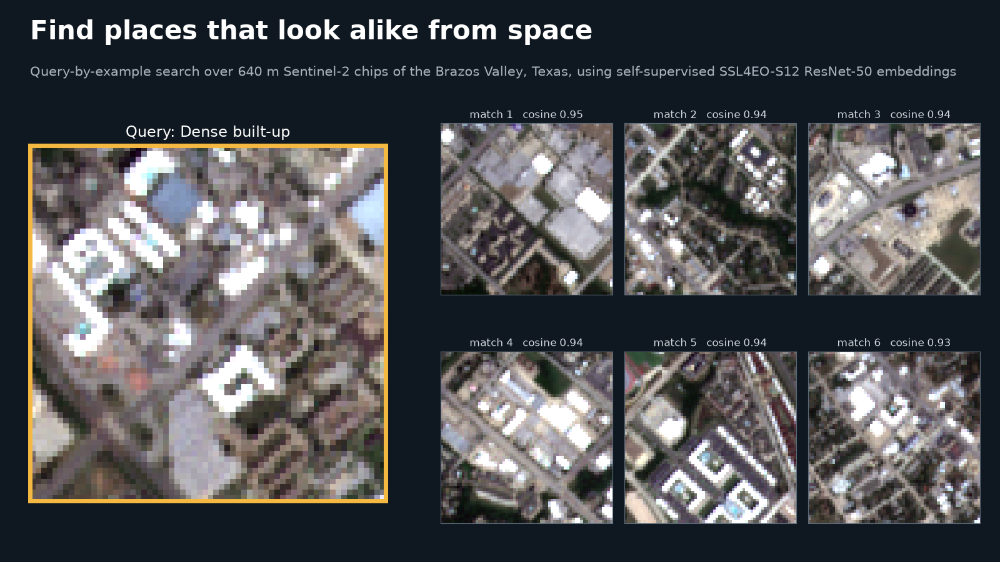
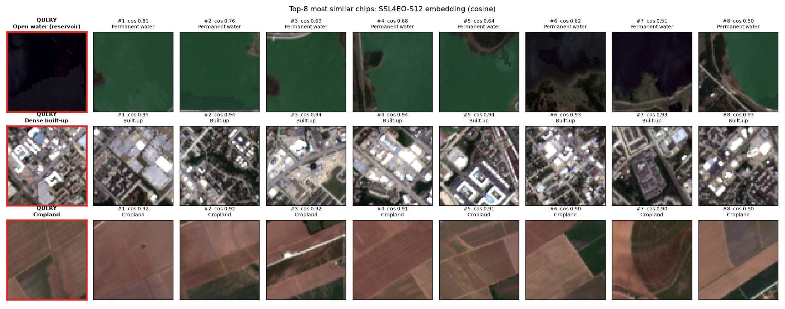
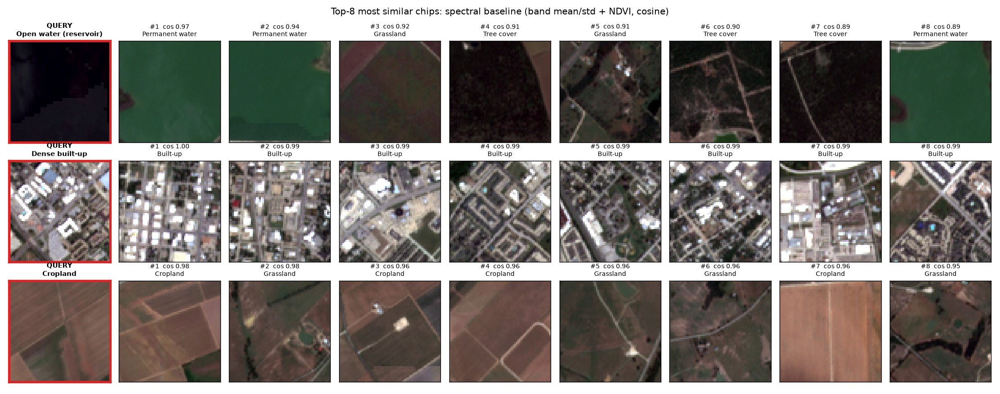
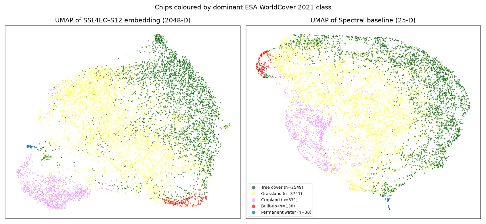
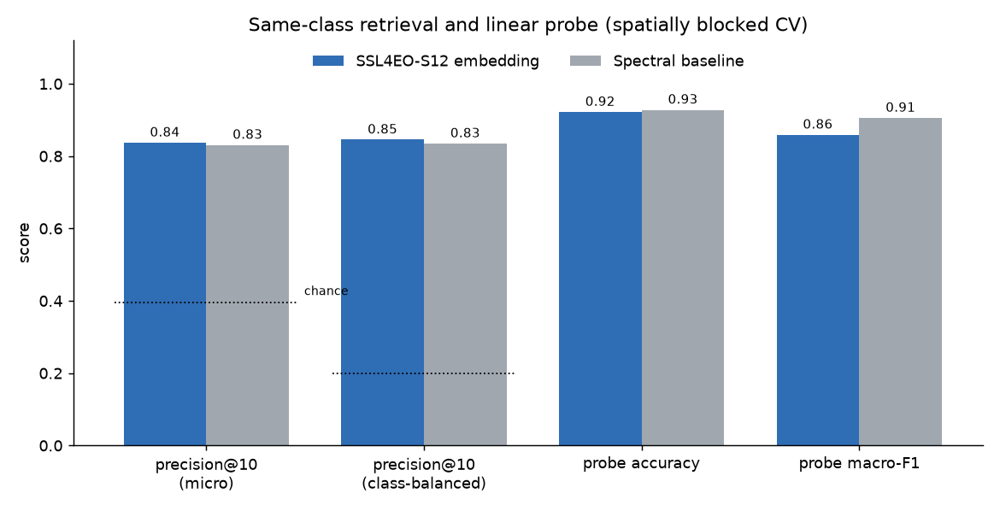

# Find places that look alike from space

Pick one 640 m patch of Sentinel-2 imagery and this project returns the patches across a 58 x 58 km area of Texas that look most like it, using embeddings from a self-supervised Sentinel-2 foundation model (SSL4EO-S12 MoCo ResNet-50). It also tests, against ESA WorldCover labels and a simple spectral baseline, how far "looks alike" matches "same land cover".

## Summary

- **Question:** Do embeddings from a self-supervised Sentinel-2 model find chips with the same land cover better than a simple 25-number spectral summary?
- **Answer:** About the same: P@5 is 0.845 for the embedding and 0.843 for the baseline (random 0.396), and the baseline has the higher probe macro-F1 (0.906 vs 0.859). Z-scoring the embedding gives the best class-balanced P@10, 0.875 vs 0.835.
- **Main limitation:** The labels are the dominant 2021 WorldCover class of each 640 m chip, a blunt label for mixed 2024 chips, and the test covers one area and one summer.



## My role

I'm a geographer: B.S. in Geography with a GIS background, now an M.S. Geography student at Texas A&M. I ran this project as the human on the loop. I owned the question, the standards and every decision about what gets published, and used Claude Code (Anthropic) as the programmer.

- **Problem framing:** I defined the question, approved the study area and data, and set what a useful, defensible answer looks like.
- **Standards:** spatially held-out validation where the data allow, methods grounded in peer-reviewed literature, honest uncertainty (intervals and stated limitations), and a stated cost for every design choice.
- **Oversight at every stage:** I reviewed the plan, the intermediate results, the figures and the write-up, challenged anything unclear or unsupported, and sent work back until it met the standard.
- **Quality control:** before publishing, every number was traced to the project's results, the references checked and the tests run. The final call on what is reported, and what is stated as a limitation, is mine.

Commits made with Claude Code carry its `Co-Authored-By` line.

## Results (Brazos Valley, Texas, summer 2024)

7,974 chips of 64 x 64 px (640 m). 7,329 chips have one WorldCover class covering at least half of the chip and were used for evaluation: tree cover 2,549, grassland 3,741, cropland 871, built-up 138, permanent water 30.

| Features | P@5 (micro / class-balanced) | P@10 | P@20 | Linear probe accuracy | Linear probe macro-F1 |
|---|---|---|---|---|---|
| SSL4EO-S12 embedding (2048-D) | 0.845 / 0.866 | 0.837 / 0.845 | 0.827 / 0.811 | 0.922 ± 0.006 | 0.859 ± 0.078 |
| SSL4EO-S12 embedding, z-scored per dimension | 0.833 / 0.881 | 0.826 / 0.875 | 0.817 / 0.849 | same as above* | same as above* |
| Spectral baseline (25-D, z-scored) | 0.843 / 0.863 | 0.831 / 0.835 | 0.815 / 0.779 | 0.928 ± 0.009 | 0.906 ± 0.017 |
| Random retrieval | 0.396 / 0.200 | same | same | | |

P@k is the share of a chip's k nearest neighbours (cosine similarity) that have the same dominant WorldCover class. Every evaluation chip is used as a query, and its 8 adjacent chips are excluded so that spatial autocorrelation cannot inflate the score. The probe is ± one standard deviation over 5 spatially blocked folds. The spectral features are z-scored before cosine search, so the z-scored embedding row puts both feature sets on the same footing. *The probe standardises every feature set internally, so its result is the same for both embedding rows. All numbers are in [`results/metrics.json`](results/metrics.json).

**Sensitivity to the exclusion zone.** Excluding a wider ring around each query (P@10, micro / class-balanced; water in brackets) lowers the class-balanced scores of all three, mostly because the 30 water chips sit in a few reservoirs:

| Excluded around query | Embedding | Embedding, z-scored | Spectral baseline |
|---|---|---|---|
| 1 chip (640 m) | 0.837 / 0.845 (0.867) | 0.826 / 0.875 (0.963) | 0.831 / 0.835 (0.777) |
| 3 chips (1.9 km) | 0.834 / 0.820 (0.777) | 0.823 / 0.855 (0.890) | 0.827 / 0.790 (0.583) |
| 5 chips (3.2 km) | 0.830 / 0.779 (0.617) | 0.819 / 0.820 (0.760) | 0.824 / 0.765 (0.487) |

The ranking holds at every radius: the z-scored embedding has the best class-balanced score, and both embedding variants beat the baseline on water.

**What the numbers say.** On coarse land-cover classes, the foundation-model embedding and a 25-number spectral summary perform about the same. The embedding is slightly better at retrieval, and the gap widens as k grows (class-balanced P@20 0.811 vs 0.779). It retrieves water and cropland better (0.867 vs 0.777 and 0.837 vs 0.814 at P@10), and grassland slightly better. Z-scoring the embedding dimensions, as the baseline already is, widens the retrieval gap further (class-balanced P@10 0.875 vs 0.835; water 0.963, cropland 0.900), at a small cost in micro precision (0.826 vs 0.831), mainly from grassland. The spectral baseline is better on tree cover and built-up, and it has the higher probe macro-F1 (0.906 vs 0.859). The embedding's F1 varies much more from fold to fold, likely because the 30 water chips fall in only a few spatial blocks. The clearest difference shows in the example queries, though three queries are anecdotes, not a test. For the three example chips below, all 8 top embedding matches share the query's class (24 of 24). For the spectral baseline it is 15 of 24: water 3/8, built-up 8/8, cropland 4/8. Spectral statistics capture colour. The examples suggest the embedding also captures spatial pattern (field geometry, street grids, shorelines), which WorldCover's dominant-class labels mostly do not reward.

| | |
|---|---|
|  |  |
|  |  |

The query chips were chosen by rule, not by hand: the purest chip of each class. Water is at Gibbons Creek Reservoir (-96.060, 30.629), built-up is in College Station (-96.347, 30.617), and cropland is in the Brazos River bottomland (-96.589, 30.801). Each query's 5 x 5 chip neighbourhood is excluded from its results, so the matches come from elsewhere in the area.

## Decisions

- **I compared the model against a simple spectral baseline and random retrieval.** Without the baseline, P@5 of 0.845 would look strong. With it, the embedding's gain on coarse land cover is small.
- **I excluded each query's 8 adjacent chips from its matches, then tested wider rings.** Nearby chips share land cover (spatial autocorrelation), so including them would inflate the score. Wider rings lower the class-balanced scores, mostly for the 30 water chips, but the ranking holds.
- **I scored the linear probe on whole 6.4 km blocks held out with `GroupKFold`, not on random folds.** The cost is that the 30 water chips fall in only a few blocks, which likely explains the embedding's wide fold-to-fold spread (macro-F1 ± 0.078).
- **I report class-balanced precision (the mean of per-class scores) next to micro precision.** Grassland and tree cover are so common that random retrieval already scores 0.40 micro, so the micro score alone flatters every method.
- **I picked the example queries by rule, the purest chip of each class, not by hand.** I still treat the three examples as anecdotes, not a test.
- **I kept only chips where one class covers at least half the chip.** A majority class means the chip's label describes most of its pixels, but shrubland, bare and wetland had too few chips (under 30) to evaluate.

## Method

1. **Imagery.** Sentinel-2 L2A from the Microsoft Planetary Computer STAC API (signed URLs). Scenes from 1 May to 30 Sep 2024 with less than 10% scene cloud were grouped by acquisition day. The 4 days that best covered the area were kept (2024-05-10, 08-08, 09-07, 09-27; 13 scenes across MGRS tiles 14RQU, 14RQV, 15RTP and 15RTQ). Pixels were masked with the Scene Classification Layer (kept: vegetation, bare soil, water, unclassified). The 12 bands were resampled to a 10 m UTM 14N grid and reduced to a per-pixel median. The processing-baseline 04.00+ offset (+1000) was removed.
2. **Labels.** ESA WorldCover 2021 v200 on the same grid (nearest neighbour). Each chip gets its dominant class and that class's share.
3. **Chips.** Non-overlapping 64 x 64 px tiles (640 m). Chips with more than 1% no-data were dropped.
4. **Embeddings.** TorchGeo `ResNet50_Weights.SENTINEL2_ALL_MOCO` (in_chans = 13), classifier removed, giving a 2048-D global-pooled feature. Inputs follow the transform TorchGeo ships with these weights (`weights.transforms`, TorchGeo 0.10): band order B1, B2, B3, B4, B5, B6, B7, B8, B8A, B9, B10, B11, B12, then Resize(256) → CenterCrop(224) → divide by 10000. L2A has no B10 (cirrus), so that band is zero-filled. Embedding all chips took 12.5 s on an RTX 4080 in the recorded run.
5. **Spectral baseline.** For each of the 12 bands, the chip mean and standard deviation, plus mean NDVI (25 features, standardised).
6. **Search.** Cosine similarity, exhaustive (the area is small enough for an exact search).
7. **Linear probe.** Standardised features, then logistic regression with balanced class weights. 5-fold `GroupKFold` holds out whole 10 x 10-chip (6.4 km) spatial blocks (block cross-validation; Roberts et al. 2017).
8. **Projection.** UMAP (cosine, 30 neighbours) of both feature sets, coloured by WorldCover class.

## How to run

```bash
conda env create -f environment.yml      # Python 3.12; PyTorch CUDA 12.6 wheels via pip
conda activate geoai-embed
pytest -q                                # fast CPU-only tests (tiling, band order, normalisation, top-k)
python run.py                            # builds a ~0.65 GB composite + labels in data/, then runs everything
python run.py --device cpu               # works without a GPU, just slower
python run.py --center-lon -101.9 --center-lat 33.6 --epsg 32614   # any other area
```

Run it from an activated environment. On Windows, calling the env's `python.exe` without activating it can load another program's GDAL DLLs. The first run took about 15 minutes, almost all of it building the composite. Later runs reuse the cached rasters (and embeddings) in `data/` and take under 2 minutes. `run.py --help` lists all options: area, dates, cloud limit, chip size, purity threshold and CV block size.

```
embedsearch/data.py      STAC search, cloud-masked median composite, WorldCover, tiling, dominant class
embedsearch/embed.py     band order, TorchGeo normalisation, GPU embedding
embedsearch/search.py    cosine top-k with neighbour exclusion
embedsearch/evaluate.py  precision@k, spectral baseline, spatially blocked linear probe
run.py                   end-to-end run, figures and results/metrics.json
```

## Limitations

- **Coarse labels.** The dominant WorldCover class of a 640 m chip is a blunt label. Most chips are mixtures, and grassland, tree cover and cropland blur into each other in this landscape. High P@k partly reflects how common grassland and tree cover are (random retrieval already scores 0.40 micro).
- **Year mismatch.** The labels are WorldCover 2021 and the imagery is 2024. Land that changed in between (new subdivisions around College Station, cleared fields) is mislabelled.
- **Similar is not the same land use.** Cosine similarity finds chips that look alike to the model. A parking lot can match a bare field, and a turbid reservoir can match another reservoir but not clear water. The retrieved chips show visual analogues, not verified matches.
- **Pretraining mismatch.** The weights were trained on Sentinel-2 L1C top-of-atmosphere imagery (SSL4EO-S12, global samples around cities). This project feeds L2A surface reflectance with a zero-filled B10. Scaling follows TorchGeo (divide by 10000, no clipping), which matches the SSL4EO-S12 README's description of the released weights ("dividing 10000") except that the README also clips to [0, 1]; the repo's pretraining script additionally offers a per-band mean ± 2σ, 8-bit scaling (its default `--dtype uint8`), so the exact pretraining scaling is not certain. The features work, but they are not tuned to this input or to central Texas. Each 64 px chip is also upsampled to the model's 224 px input.
- **Composite artefacts.** The median combines four dates. Cloud-mask edges from the 20 m SCL layer and tile seams can leave stair-step patterns in a few chips (visible in the water query).
- **Small rare classes.** Only 30 water and 138 built-up chips pass the purity filter, so per-class scores for them are noisy. Shrubland, bare and wetland chips were too few to evaluate (under 30).
- **One area, one season.** These results cover a single ~3,300 km² area and one summer. They are not a benchmark.

## References

- Wang, Y., Braham, N. A. A., Xiong, Z., Liu, C., Albrecht, C. M., & Zhu, X. X. (2022). SSL4EO-S12: A large-scale multi-modal, multi-temporal dataset for self-supervised learning in Earth observation. arXiv:2211.07044 (https://doi.org/10.48550/arXiv.2211.07044). Published in *IEEE Geoscience and Remote Sensing Magazine*, 11(3), 98–106 (2023). https://doi.org/10.1109/MGRS.2023.3281651
- Stewart, A. J., Robinson, C., Corley, I. A., Ortiz, A., Lavista Ferres, J. M., & Banerjee, A. (2022). TorchGeo: Deep learning with geospatial data. *Proceedings of the 30th International Conference on Advances in Geographic Information Systems (SIGSPATIAL '22)*. https://doi.org/10.1145/3557915.3560953
- He, K., Fan, H., Wu, Y., Xie, S., & Girshick, R. (2020). Momentum contrast for unsupervised visual representation learning. *CVPR 2020*, 9726–9735. https://doi.org/10.1109/CVPR42600.2020.00975
- Zanaga, D., Van De Kerchove, R., Daems, D., De Keersmaecker, W., Brockmann, C., Kirches, G., et al. (2022). ESA WorldCover 10 m 2021 v200. Zenodo. https://doi.org/10.5281/zenodo.7254221
- McInnes, L., Healy, J., & Melville, J. (2018). UMAP: Uniform manifold approximation and projection for dimension reduction. arXiv:1802.03426. https://doi.org/10.48550/arXiv.1802.03426
- Roberts, D. R., Bahn, V., Ciuti, S., et al. (2017). Cross-validation strategies for data with temporal, spatial, hierarchical, or phylogenetic structure. *Ecography*, 40(8), 913–929. https://doi.org/10.1111/ecog.02881

## Data and model licences

- **Sentinel-2 L2A**: Copernicus Sentinel data 2024, free and open under the Copernicus data licence ("Contains modified Copernicus Sentinel data 2024"), accessed through Microsoft Planetary Computer.
- **ESA WorldCover 2021 v200**: © ESA WorldCover project 2021 / contains modified Copernicus Sentinel data (2021) processed by the ESA WorldCover consortium. CC BY 4.0.
- **SSL4EO-S12 pretrained weights**: released by the SSL4EO-S12 authors under CC BY 4.0 (the SSL4EO-S12 code is Apache 2.0). Loaded through TorchGeo (MIT).
- **This code**: MIT, see [LICENSE](LICENSE).

Large rasters, chips and embeddings stay in the git-ignored `data/` folder. Only figures and `results/metrics.json` are committed.
